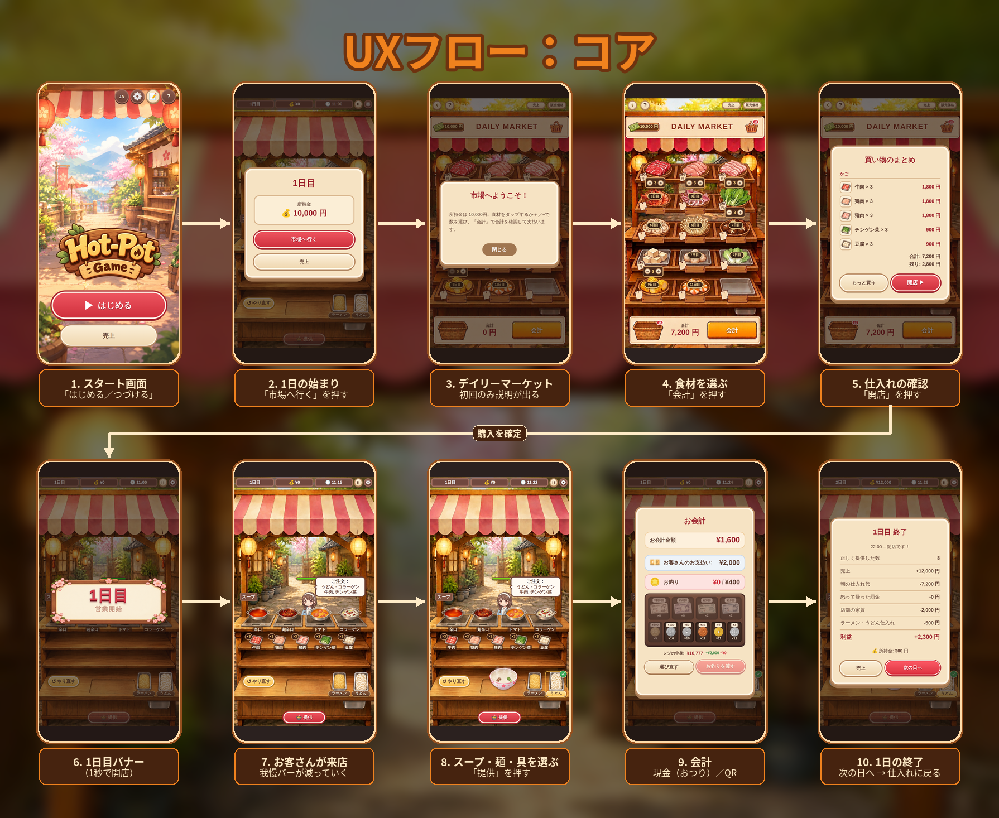
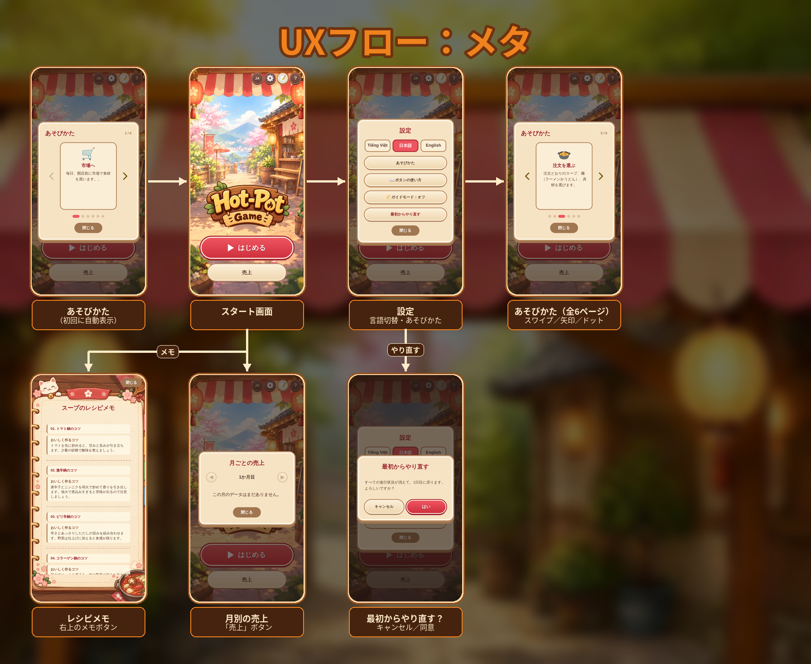
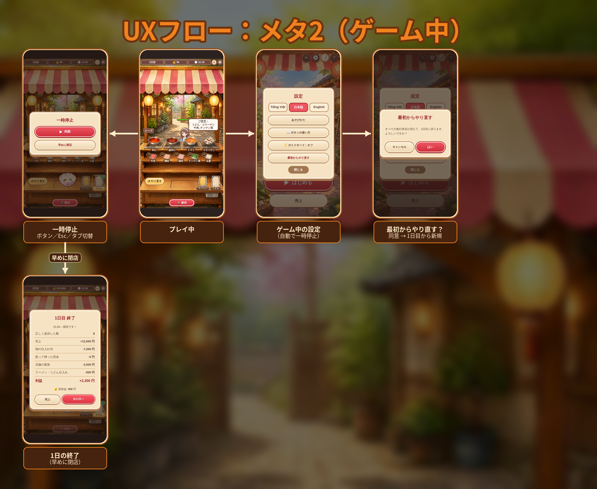

# 火鍋の店 (Hot-Pot Game)

火鍋店を経営する2D接客ゲームです。仕入れ（Daily Market）で食材を買い、お客さんの注文どおりにスープ・麺・具を選んで提供し、会計（現金のおつり／QR）まで行います。HTML / CSS / JavaScript のみで動作し、進行状況は localStorage と Supabase（匿名ログイン）に保存されます。

## UXフロー

### コア（1日の流れ）

スタート画面 → 1日の始まり → 仕入れ → 開店 → 接客 → 会計 → 1日の終了 → 翌日の仕入れ、の繰り返しです。

### メタ（スタート画面のサブ画面）

あそびかた、設定、レシピメモ、月別の売上、やり直す確認です。

### メタ2（ゲーム中のサブ画面）

一時停止、ゲーム中の設定、やり直す、早めに閉店です。

## ファイル構成

| ファイル | 内容 |
| --- | --- |
| `index.html` | ゲーム本体（画面・ロジック・スタイル） |
| `supabase.js` | クラウドセーブとプレイ履歴の保存 |
| `img/` | 画像素材 |
| `docs/ux/` | UXフロー図 |
